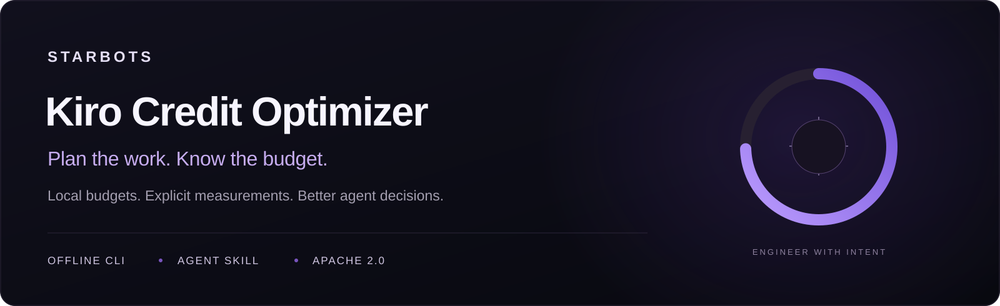
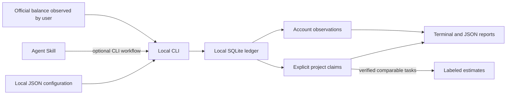

<div align="center">



<br />

[](pyproject.toml)
[](#install)
[](LICENSE)
[](.kiro/skills/kiro-credit-optimizer/SKILL.md)

**Plan Kiro credit budgets, record balance snapshots and spot wasted agent work, with a local CLI and a portable Agent Skill.**

[Quick start](#quick-start) &nbsp; · &nbsp; [Usage guide](docs/USAGE.md) &nbsp; · &nbsp; [Add the Skill](#add-the-skill-to-your-agent) &nbsp; · &nbsp; [starbots.dev](https://starbots.dev)

</div>

---

## What it is

Kiro Credit Optimizer has two parts that work together:

- **A local CLI, `starbots-kco`.** A small Python tool that keeps a ledger of your Kiro credit balances on your own machine. You set a budget, record the balances you read in Kiro, and get reports, advisory alerts and planning estimates. It uses only the Python standard library and makes no network requests.
- **A portable Agent Skill, `kiro-credit-optimizer`.** Instructions that an AI coding agent loads when they are relevant. They guide the agent to define scope, reuse context, choose a model deliberately, diagnose failures before retrying and keep the tests that matter, so fewer credits go to repeated or avoidable work. The Skill follows the [Agent Skills format](https://agentskills.io/specification), so Kiro, Claude Code, Codex and other compatible agents can load it.

The Skill is useful on its own. The CLI is optional and adds exact numbers and history.

**Necessary security, integrity and correctness checks always take priority over credit savings.**

## What it's for

It is for developers and small teams who use Kiro and want to know where their credits go, and for anyone who wants their coding agent to work with a budget in mind. Typical situations:

- **Planning a scoped Kiro task budget.** Before a bug fix or a feature, set a project budget with a reserve, split it across phases (discovery, planning, implementation, testing, review), allocate tasks and sessions, and get a labeled estimate range that states its assumptions.
- **Recording balance snapshots.** Write down the balance Kiro shows you, for example in `/usage`, with a timestamp and a source label. The ledger keeps exact amounts and provenance, and reports what changed between snapshots within each monthly renewal cycle.
- **Spotting credit waste.** Compare attributed usage with phase, task and session budgets, see advisory alerts at 50%, 75% and 90% (configurable) and review deviations. The Skill steers the agent away from repeated discovery, overlapping agents and blind retries.

## What's included

| Part | Location | Details |
|---|---|---|
| CLI and Python package | `src/starbots_kco/`, `kco.py` | Budgets, snapshots, claims, reports, estimates, health check and export; human or `--json` output |
| Agent Skill | `.kiro/skills/kiro-credit-optimizer/` | `SKILL.md` with references for the CLI, measurements and an efficient workflow |
| Synthetic demo | `examples/demo.py` | Runs the full workflow in a temporary directory, then deletes it |
| Tests | `tests/` | Unit and CLI tests with synthetic data |
| Documentation | `docs/` | [Usage guide](docs/USAGE.md), [architecture](docs/ARCHITECTURE.md), [data handling](docs/DATA_HANDLING.md) |

## Install

Requires Git and **Python 3.11 or later**. The package is not published to PyPI; install it from a clone.

**Windows PowerShell**

```powershell
git clone https://github.com/Starbots-devv/kiro-credit-optimizer.git
Set-Location .\kiro-credit-optimizer
py -3 -m venv .venv
.\.venv\Scripts\python.exe -m pip install .
.\.venv\Scripts\starbots-kco.exe --version
```

**macOS and Linux**

```bash
git clone https://github.com/Starbots-devv/kiro-credit-optimizer.git
cd kiro-credit-optimizer
python3 -m venv .venv
.venv/bin/python -m pip install .
.venv/bin/starbots-kco --version
```

Installation may download the Python packaging toolchain. After that, every command runs offline. You can also skip installation and run the CLI straight from the clone with `python kco.py` (`py -3 kco.py` on Windows).

## Quick start

Run the synthetic demo first. It creates a temporary ledger, runs the whole workflow and removes the data afterward:

```bash
python examples/demo.py
```

Then try the workflow yourself. The balances and dates below are synthetic. Before you record real balances in another project, add `.kiro-credits/` to that project's `.gitignore`.

```bash
python kco.py init --project example-app --monthly 2000 --budget 1000 --reserve 100
python kco.py snapshot --balance 1800 --at 2026-01-02T12:00:00Z --reference "Synthetic starting balance"
python kco.py snapshot --balance 1700 --at 2026-01-03T12:00:00Z --reference "Synthetic ending balance"
python kco.py claim 1 2 --phase implementation --exclusive-account
python kco.py report --as-of 2026-01-04
python kco.py estimate --task-type bugfix --complexity small --retries 1 --json
```

Use `starbots-kco` instead of `python kco.py` if you installed the package; on Windows use `py -3` and on macOS/Linux `python3` where needed. What each step does:

1. `init` creates `.kiro-credits/` with a configuration file and a SQLite ledger: a 1,000-credit project budget with a 100-credit reserve, split across five phases.
2. The two `snapshot` commands record balances. A report at this point shows 100 credits of account activity but **0 credits attributed to the project**, because an account balance can include unrelated work.
3. `claim` attributes the interval between snapshots `1` and `2` to the implementation phase. Use it only when you can confirm that nothing else used the account during that interval.
4. `report` now shows 100 credits attributed and **800 spendable credits remaining**, with the 100-credit reserve kept separate.
5. `estimate` returns a labeled range for a small bug fix with one expected retry, together with its assumptions and a low-confidence flag.

To keep the ledger somewhere else, put the global `--data-dir` option before the command, for example `starbots-kco --data-dir ../kiro-ledger status --json`. The [usage guide](docs/USAGE.md) covers every option.

### Commands

| Command | Purpose |
|---|---|
| `init` | Create a validated budget and a local SQLite ledger |
| `budget` | Adjust monthly/project allocations, reserve, phases, tasks, sessions or thresholds |
| `snapshot` | Record a balance with source, timestamp, reference and optional context |
| `claim` | Attribute an exclusive, non-overlapping interval to the project |
| `status` / `report` | Show current or historical cycle observations and budgets |
| `estimate` | Produce a labeled range and state its assumptions |
| `config` | Show the validated configuration |
| `doctor` | Check configuration, runtime and database integrity |
| `export` | Write configuration, snapshots and claims to stdout |

Each command accepts `--json` and `--help`. Credit values in JSON are decimal strings with up to six fractional digits.

## Add the Skill to your agent

The Skill is the folder `.kiro/skills/kiro-credit-optimizer/`. Copy the whole folder, keeping its name, into the skills directory that your agent reads. Adding the Skill does **not** install the CLI.

| Agent | Project-level location | User-level location |
|---|---|---|
| Kiro (IDE and CLI) | `.kiro/skills/kiro-credit-optimizer/` | `~/.kiro/skills/kiro-credit-optimizer/` |
| Claude Code | `.claude/skills/kiro-credit-optimizer/` | `~/.claude/skills/kiro-credit-optimizer/` |
| Codex | `.agents/skills/kiro-credit-optimizer/` | See the Codex documentation |

For example, to add it to another project for Claude Code, run this from the root of your clone (replace `../your-project`, and use `.kiro/skills` or `.agents/skills` for the other agents):

```bash
mkdir -p ../your-project/.claude/skills
cp -R .kiro/skills/kiro-credit-optimizer ../your-project/.claude/skills/
```

```powershell
New-Item -ItemType Directory -Force ..\your-project\.claude\skills | Out-Null
Copy-Item -Recurse .kiro\skills\kiro-credit-optimizer ..\your-project\.claude\skills\
```

**Kiro IDE import from GitHub:** open **Agent Steering & Skills → + → Import a skill → GitHub** and paste this folder URL:

```text
https://github.com/Starbots-devv/kiro-credit-optimizer/tree/main/.kiro/skills/kiro-credit-optimizer
```

**Kiro custom agents:** include the skill in the agent's `resources`:

```json
{
  "name": "budget-aware-engineer",
  "resources": ["skill://.kiro/skills/*/SKILL.md"]
}
```

Once it is in place, the agent can load the Skill when a request matches its description, or you can invoke it by name where your agent supports that, for example `/kiro-credit-optimizer`. An example request:

> Plan this bug fix against our budget, reuse existing context, and keep the necessary regression and security checks.

The Skill is written for Kiro credits. In other agents its general guidance (scope, context reuse, diagnosing before retrying, keeping necessary tests) still applies; Kiro-specific steps such as reading `/usage` only apply if you use Kiro. See [Kiro's Skill documentation](https://kiro.dev/docs/skills/) and the [Skill entry point](.kiro/skills/kiro-credit-optimizer/SKILL.md).

## How it works



Configuration, storage, reports and estimation are separate Python modules. SQLite transactions protect snapshot and claim writes, and integer microcredits keep entered amounts exact. A balance increase or a renewal boundary never silently becomes project consumption. See the [architecture notes](docs/ARCHITECTURE.md).

| Figure | Meaning |
|---|---|
| Official balance, manually entered | A user transcription; not independently authenticated |
| Official-report or authorized-local source | Provenance supplied by the user; nothing is imported or collected automatically |
| Observed account difference | Consumption between comparable snapshots, which may include other work |
| Attributed project usage | An interval the user claimed as exclusive to the project |
| Task estimate / cycle projection | A planning calculation with stated assumptions and confidence |

## Limits

- **Alpha.** This is version 0.1.0. Commands and storage formats may change.
- **Estimates, not billing.** Estimates use transparent, uncalibrated planning weights until you have at least three comparable verified tasks. They are not Kiro prices, token conversions or billing forecasts. Kiro's own billing pages and [`/usage`](https://kiro.dev/docs/reference/slash-commands/) remain the authority.
- **No account access.** The tool never signs in to Kiro, calls an API or reads credentials, prompts, responses or session data. You enter balances yourself, and the tool cannot verify them.
- **Advisory only.** Alerts do not pause Kiro, switch models or enforce a spending cap.
- **Attribution depends on you.** A balance difference becomes project usage only after you claim the interval and confirm that nothing else used the account.
- **Local files, not encrypted.** Protect the data directory and review exports before sharing them. See [data handling](docs/DATA_HANDLING.md).
- **Skill activation is not automatically tested.** The test suite checks the CLI and the Skill's format, not its behavior inside a particular version of Kiro, Claude Code or Codex.
- **No savings claims.** No measured credit savings are published.

This is an independent project and is not affiliated with or endorsed by Kiro, AWS, Anthropic or OpenAI.

## Development

From a clone with Python 3.11+:

```bash
python -m pip install -r requirements-dev.txt
python -m pip install --no-build-isolation --no-deps -e .
python -m unittest discover -s tests -v
python -m ruff check .
python scripts/check_repository.py
```

The CI workflow runs these checks, plus formatting, the demo and a package build, on Windows, macOS and Linux with Python 3.11, 3.12 and 3.13. See [CONTRIBUTING.md](CONTRIBUTING.md) for the full list. Report bugs through [GitHub Issues](https://github.com/Starbots-devv/kiro-credit-optimizer/issues) and security problems as described in [SECURITY.md](SECURITY.md).

## License

Licensed under the [Apache License 2.0](LICENSE). See [NOTICE](NOTICE). The Skill folder includes the same license and notice, so it can be copied on its own.

**Made by Starbots — [https://starbots.dev](https://starbots.dev)**

## Resumen en español

**Kiro Credit Optimizer** es una herramienta de Starbots para planificar y controlar el uso de créditos de Kiro. Tiene dos partes:

- **CLI local (`starbots-kco`)**: guarda en tu equipo los saldos que ves en Kiro, define presupuestos por proyecto, fase, tarea y sesión, y genera reportes con alertas orientativas (50 %, 75 % y 90 %, configurables) y estimaciones de tareas. Solo usa la biblioteca estándar de Python 3.11+ y no hace peticiones de red.
- **Agent Skill portátil (`kiro-credit-optimizer`)**: guía al agente para acotar el trabajo, reutilizar contexto, elegir el modelo con criterio, diagnosticar antes de reintentar y mantener las pruebas necesarias.

**Para qué sirve:** planificar el presupuesto de una tarea acotada en Kiro, registrar instantáneas del saldo con fecha y fuente, y detectar desperdicio de créditos comparando el uso atribuido con lo asignado. Está pensada para desarrolladores y equipos pequeños que usan Kiro.

**Instalación:** clona el repositorio, crea un entorno virtual e instala con `pip install .` (ver [Install](#install)). Empieza con `python examples/demo.py`, que usa datos sintéticos.

**Añadir la Skill:** copia la carpeta completa `.kiro/skills/kiro-credit-optimizer/` a `.kiro/skills/` (Kiro), `.claude/skills/` (Claude Code) o `.agents/skills/` (Codex) en tu proyecto.

**Límites:** versión alfa; las estimaciones no son facturación oficial; no accede a tu cuenta de Kiro ni lee credenciales (los saldos los introduces tú); las alertas no bloquean el gasto.

**Licencia:** Apache 2.0. Hecho por Starbots — [https://starbots.dev](https://starbots.dev)
